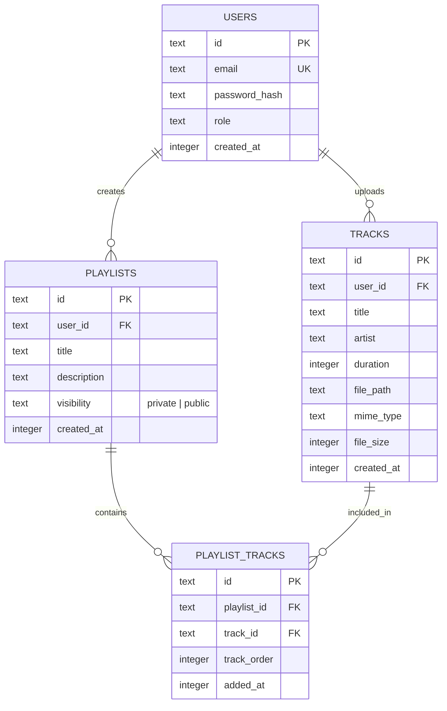

# Project Architecture & Strategy: Stealth Audio Streamer

## 1. Executive Summary

The objective of this project is to develop a lightweight, secure, and private web-based audio streaming platform. A key design constraint is that **the platform must not appear as an entertainment or media streaming service on any network filter, firewall, or search engine**. 

All data is locked behind a strict authentication wall—unauthenticated visitors cannot browse, preview, or detect the nature of the application.

---

## 2. Stealth & Anti-Categorization Strategy

Enterprise firewalls, DNS filters (e.g., Cisco Umbrella, Cloudflare Gateway, Fortinet), and web scrapers classify websites based on domain names, page titles, OpenGraph tags, and public landing page content. To remain categorized as a neutral utility/portal:

### 2.1 Domain & DNS Profile
* **Domain Naming**: Avoid keywords such as `music`, `audio`, `stream`, `beats`, `tunes`, `sound`, or `media`.
* **Recommended Naming Conventions**: Generic productivity or storage names (e.g., `docspace.io`, `vault-storage.com`, `personal-sync.net`, `portal-workspace.org`).
* **DNS Categorization Target**: *Information Technology*, *Business / Personal Storage*, or *Uncategorized / Private Portal*.

### 2.2 Hard Authentication Wall (Zero Public Data)
* **No Public Landing Page**: Visiting the root URL (`/`) immediately displays a clean, minimalist login portal titled **"Workspace Portal"** or **"Personal Vault"**.
* **Strict Route Guards**: All sub-routes (`/app`, `/library`, `/api/*`) require an active authenticated session. Unauthenticated requests are immediately redirected to `/login` or return `401 Unauthorized`.
* **No Unauthenticated Previews**: Track metadata, playlists, user lists, and media files are completely inaccessible without valid credentials.

### 2.3 Search Engine & Crawler Cloaking
* **`robots.txt`**: Completely block indexing across all engines:
  ```txt
  User-agent: *
  Disallow: /
  ```
* **HTML Head Tags**:
  ```html
  <meta name="robots" content="noindex, nofollow, noarchive, nosnippet" />
  <title>Portal | Secure Workspace</title>
  ```
* **OpenGraph / Social Card Stripping**: Remove all social preview tags (`og:title`, `og:image`, `og:type=music.song`, `twitter:card`).

---

## 3. Technology Stack Comparison & Recommendation

### Recommended Stack: Fullstack Next.js + SQLite/PostgreSQL + Drizzle ORM

| Layer | Recommended Choice | Rationale |
|---|---|---|
| **Frontend** | **Next.js (React / App Router)** | Server components provide instant auth checks before rendering. Custom HTML5 Audio API integration. |
| **Backend** | **Next.js Route Handlers (Node.js)** | Single codebase; native support for streaming byte ranges (`HTTP 206 Partial Content`). |
| **Database** | **SQLite (via LibSQL / better-sqlite3)** | Single-file, zero RAM overhead (~15MB), zero operational complexity. Easily swapped with PostgreSQL if scaling. |
| **ORM** | **Drizzle ORM** | Type-safe, ultra-lightweight, zero cold-start penalty, plain SQL-like query builder. |
| **Authentication** | **Jose / Session Cookie** | HTTP-only, `Secure`, `SameSite=Strict` cookies. No client-side token exposure. |
| **File Storage** | **Cloudflare R2** or **Protected Local Disk** | Local storage for zero-cost self-hosting; Cloudflare R2 for cloud storage with **$0 egress fees** (ideal for audio streaming bandwidth). |

---

## 4. Database Schema Design



### Access Control Rules:
* **Private Playlists**: Accessible **only** if `playlist.user_id === session.user_id`.
* **Public Playlists**: Accessible **only to authenticated logged-in users** (`session.user_id IS NOT NULL`). Even "public" playlists are invisible to anonymous visitors.

---

## 5. Audio Streaming & Range Request Architecture

Browsers require **HTTP 206 Partial Content** (byte-range streaming) to support audio seeking, scrubbing, and continuous buffering without downloading the entire file upfront.

### 5.1 Request / Response Flow
```
Client (Audio Player)                     Server (/api/tracks/[id]/stream)
        |                                                |
        |--- 1. GET /api/stream?id=... (with Cookie) --->|
        |    Range: bytes=0-1048575                      |
        |                                                |-- 2. Verify Session Cookie
        |                                                |-- 3. Check Track Permissions
        |                                                |-- 4. Read File Slice (1MB)
        |<-- 5. HTTP 206 Partial Content ----------------|
        |    Content-Range: bytes 0-1048575/5242880      |
        |    Content-Length: 1048576                     |
        |    Content-Type: audio/mpeg                    |
```

### 5.2 Server Streaming Implementation Pattern (Node.js)
```typescript
import fs from 'fs';
import { NextRequest, NextResponse } from 'next/server';

export async function GET(req: NextRequest, { params }: { params: { id: string } }) {
  // 1. Validate authenticated session
  const session = await getSession(req);
  if (!session) return new NextResponse('Unauthorized', { status: 401 });

  // 2. Fetch track metadata and verify access
  const track = await getTrackById(params.id, session.userId);
  if (!track) return new NextResponse('Forbidden', { status: 403 });

  const stat = fs.statSync(track.filePath);
  const fileSize = stat.size;
  const range = req.headers.get('range');

  if (range) {
    const parts = range.replace(/bytes=/, '').split('-');
    const start = parseInt(parts[0], 10);
    const end = parts[1] ? parseInt(parts[1], 10) : fileSize - 1;
    const chunkSize = end - start + 1;
    const fileStream = fs.createReadStream(track.filePath, { start, end });

    return new Response(fileStream as any, {
      status: 206,
      headers: {
        'Content-Range': `bytes ${start}-${end}/${fileSize}`,
        'Accept-Ranges': 'bytes',
        'Content-Length': chunkSize.toString(),
        'Content-Type': track.mimeType,
      },
    });
  }

  const fileStream = fs.createReadStream(track.filePath);
  return new Response(fileStream as any, {
    status: 200,
    headers: {
      'Content-Length': fileSize.toString(),
      'Content-Type': track.mimeType,
    },
  });
}
```

---

## 6. Security & Hardening Checklist

1. **Authentication**:
   - Passwords hashed using **Argon2id** or **bcrypt** (salt rounds >= 12).
   - Session tokens stored in `httpOnly`, `secure`, `sameSite: 'strict'` cookies.
2. **Rate Limiting**:
   - Strict rate limiter on `/api/auth/login` (max 5 failed attempts per 15 minutes) to prevent brute force.
3. **File Upload Security**:
   - Whitelist file extensions and MIME types (`audio/mpeg`, `audio/flac`, `audio/ogg`, `audio/wav`, `audio/aac`).
   - Validate magic bytes on upload to ensure non-audio files (e.g., executables/scripts) cannot be uploaded.
   - Store audio files outside the public web root (`./storage/audio/` instead of `./public/`).
4. **Header Hardening**:
   - `X-Content-Type-Options: nosniff`
   - `X-Frame-Options: DENY`
   - `Referrer-Policy: no-referrer`
   - `Content-Security-Policy: default-src 'self'`

---

## 7. Implementation Roadmap

1. **Phase 1: Project Scaffolding & Design System**
   - Initialize Next.js project with TypeScript.
   - Configure SQLite database + Drizzle ORM schema.
   - Build neutral, stealth login page.
2. **Phase 2: Authentication & Route Protection**
   - Implement user registration, login, and session cookies.
   - Configure Next.js middleware to block all unauthenticated routes.
3. **Phase 3: File Upload & Streaming Engine**
   - Build secure file upload endpoint with MIME validation.
   - Implement HTTP 206 Partial Content streaming endpoint.
4. **Phase 4: Library & Playlist Management**
   - Playlist CRUD with public/private toggle.
   - Playlist track reordering.
5. **Phase 5: Audio Player Interface**
   - Minimalist, responsive audio player (play/pause, seek, volume, queue management).
